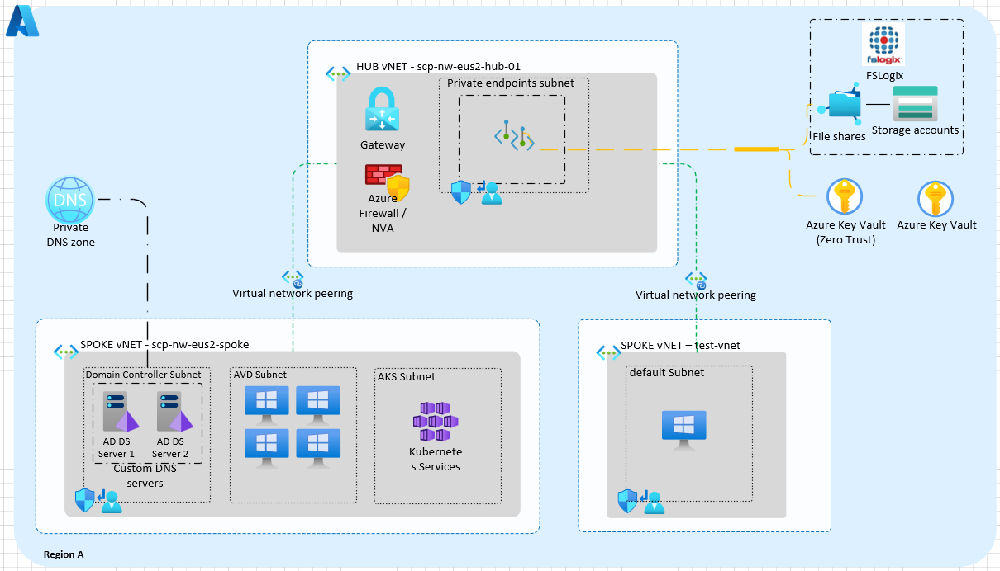

# Azure AVD Private Endpoint + Custom DNS Baseline

This guide was created to help professionals understand how Private Endpoints work in Azure, with a special focus on DNS resolution, implementation, and troubleshooting. I chose an Azure Virtual Desktop (AVD) scenario to provide practical context. Because this guide is intended to explain how the solution works end to end, all steps are shown using the Azure portal. The approach is aligned with the AVD Accelerator guidance (https://github.com/Azure/avdaccelerator).

## Guide format

This is a **README-centric guide**. You can complete the implementation from this page only.  
The `/docs` folder remains available for deep-dive references and troubleshooting details.

## Architecture design artifact

For the formal Hub-Spoke design aligned to Step 0 requirements, use:

- [Design: Hub-Spoke with Private Endpoints and Custom DNS](docs/00-design-hub-spoke-and-dns.md)
- Diagram source file: `diagrams/avd-private-endpoint-dns-topology.mmd`

## Environment definitions (custom baseline)

To make the flow clear, this is the model used in this implementation:

- Network topology uses **Hub-Spoke**.
- Virtual Machines are created in **Spoke** networks according to role and segmentation.
- Private Endpoints (PE) use a dedicated subnet in the **Hub VNet**.
- The environment uses **Active Directory**, and DNS runs on Domain Controllers.
- At least one Domain Controller is deployed in Azure (recommended: two).
- Private DNS Zones for Storage and Key Vault are pre-created or created as part of prerequisites.

## What this guide covers

- End-to-end prerequisites and architecture decisions.
- Storage Account (**FileStorage + Premium**) setup for AVD FSLogix profiles.
- Private Endpoint placement in the **Hub** network.
- Private DNS Zone creation and linkage.
- AD DS DNS forwarder configuration (custom DNS scenario).
- Key Vault private access pattern aligned with the same DNS and networking model.
- Validation and troubleshooting.

## Reference baseline (sanitized)

> Sensitive identifiers should stay redacted in documentation and screenshots.

| Component | Baseline Pattern |
|---|---|
| Region | East US 2 |
| Network model | Hub/Spoke |
| Hub VNet CIDR | 10.0.0.0/16 |
| Hub PE subnet | `Private_EndPoint` (`10.0.100.0/24`) |
| Spoke VNet CIDR | 10.1.0.0/16 |
| Domain Controller subnet | `10.1.1.0/24` |
| AVD session host subnet | `10.1.2.0/24` |
| Custom DNS servers used by VNets | `10.1.1.4`, `10.1.1.5` |
| Private DNS zones | `privatelink.file.core.windows.net`, `privatelink.vaultcore.azure.net` |

## Why Hub-based Private Endpoints make sense for AVD

- Centralizes private ingress/egress control and policy.
- Scales across multiple AVD pools/spokes without duplicating endpoint strategy.
- Keeps DNS resolution predictable with one custom DNS authority plane (AD DS DNS).
- Standardizes private link patterns for both Storage and Key Vault.

## Step-by-step implementation (Portal-first)

## Step 0 - Prerequisites

1. Confirm Hub/Spoke VNets are deployed and peered.
2. Confirm dedicated PE subnet exists in Hub.
3. Confirm AD DS DNS servers are reachable from AVD subnets.
4. Confirm or create private DNS zones:
   - `privatelink.file.core.windows.net`
   - `privatelink.vaultcore.azure.net`
5. Confirm VNet DNS settings point to AD DS DNS IPs.

[SCREENSHOT: 00-A - Hub VNet and PE subnet]  
[SCREENSHOT: 00-B - Spoke VNet and AVD subnet]  
[SCREENSHOT: 00-C - VNet DNS settings using AD DS DNS]



## Step 1 - Create Storage Account for AVD Files Premium

1. Go to **Storage accounts** > **Create**.
2. Set:
   - Account kind: **FileStorage**
   - Performance: **Premium**
   - Redundancy: **LRS**
3. In Networking, set public access based on rollout policy (final state should be private-only).
4. Create the file share for FSLogix profiles.

[SCREENSHOT: 01-A - Storage account basics]  
[SCREENSHOT: 01-B - Storage networking settings]  
[SCREENSHOT: 01-C - Premium file share created]

## Step 2 - Create Storage Private Endpoint in Hub

1. Open the storage account > **Networking** > **Private endpoint connections** > **+ Private endpoint**.
2. Select sub-resource: **file**.
3. Place PE in Hub VNet PE subnet.
4. Integrate with `privatelink.file.core.windows.net`.
5. Confirm PE status is **Approved**.

[SCREENSHOT: 02-A - Storage PE creation wizard]  
[SCREENSHOT: 02-B - PE subnet in Hub]  
[SCREENSHOT: 02-C - PE connection approved]

## Step 3 - Configure AD DS DNS conditional forwarders

1. On Azure-hosted Domain Controller DNS server(s), open **DNS Manager**.
2. Under **Conditional Forwarders**, add:
   - `privatelink.file.core.windows.net` -> `168.63.129.16`
   - `privatelink.vaultcore.azure.net` -> `168.63.129.16`
3. Replicate in AD as required.

Why: the DNS server inside Azure receives the query and forwards Azure private-link zones to Azure DNS.

[SCREENSHOT: 03-A - Conditional forwarder for file zone]  
[SCREENSHOT: 03-B - Conditional forwarder for key vault zone]

## Step 4 - Create Key Vault Private Endpoint in Hub

1. Open Key Vault > **Networking** > **Private endpoint connections** > **+ Private endpoint**.
2. Select sub-resource: **vault**.
3. Place PE in Hub VNet PE subnet.
4. Integrate with `privatelink.vaultcore.azure.net`.
5. Confirm PE status is **Approved**.

[SCREENSHOT: 04-A - Key Vault PE creation wizard]  
[SCREENSHOT: 04-B - Key Vault PE approved]

## Step 5 - Validate end to end

From AVD session host and DNS server, validate:

```powershell
nslookup <storageaccount>.file.core.windows.net
nslookup <keyvault>.vault.azure.net
Test-NetConnection <storageaccount>.file.core.windows.net -Port 445
Test-NetConnection <keyvault>.vault.azure.net -Port 443
```

Expected result: DNS resolves to private IPs and network access works through private endpoints.

[SCREENSHOT: 05-A - nslookup storage private IP]  
[SCREENSHOT: 05-B - nslookup key vault private IP]  
[SCREENSHOT: 05-C - port 445 test success]

## Step 6 - Screenshot redaction and publishing checklist

Before publishing:

- Redact subscription ID, tenant ID, public IPs, hostnames, and user identities.
- Use opaque masking (not blur).
- Validate at zoom to ensure no sensitive text remains.
- Keep screenshot names consistent in `assets/screenshots/`.

See full checklist: [Screenshot redaction QA](docs/06-screenshot-redaction-checklist.md).

## Deep-dive documents

- [Design: Hub-Spoke with Private Endpoints and Custom DNS](docs/00-design-hub-spoke-and-dns.md)
- [Architecture and prerequisites](docs/01-architecture-and-prereqs.md)
- [Storage Files Premium + Private Endpoint](docs/02-storage-files-premium-and-private-endpoint.md)
- [Key Vault Private Endpoint](docs/03-key-vault-private-endpoint.md)
- [Custom DNS forwarders on AD DS](docs/04-custom-dns-forwarders-on-ad-ds.md)
- [Validation and troubleshooting](docs/05-validation-and-troubleshooting.md)
- [Microsoft reference links](docs/07-microsoft-reference-links.md)

## Repository structure

```text
.
├─ README.md
├─ diagrams/
│  └─ avd-private-endpoint-dns-topology.mmd
├─ docs/
│  ├─ 00-design-hub-spoke-and-dns.md
│  ├─ 01-architecture-and-prereqs.md
│  ├─ 02-storage-files-premium-and-private-endpoint.md
│  ├─ 03-key-vault-private-endpoint.md
│  ├─ 04-custom-dns-forwarders-on-ad-ds.md
│  ├─ 05-validation-and-troubleshooting.md
│  ├─ 06-screenshot-redaction-checklist.md
│  └─ 07-microsoft-reference-links.md
└─ assets/
   └─ screenshots/
      └─ .gitkeep
```
