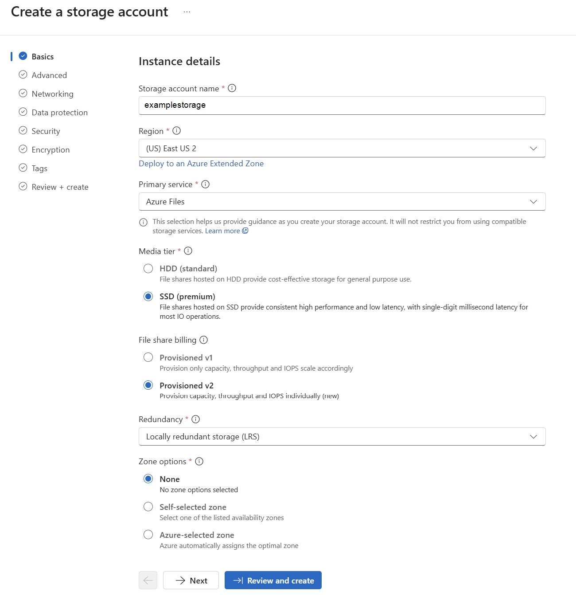
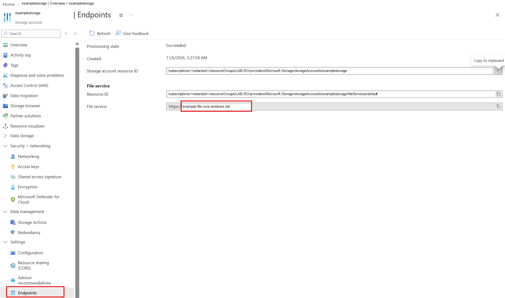
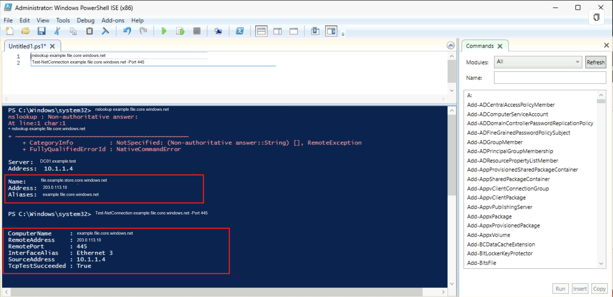
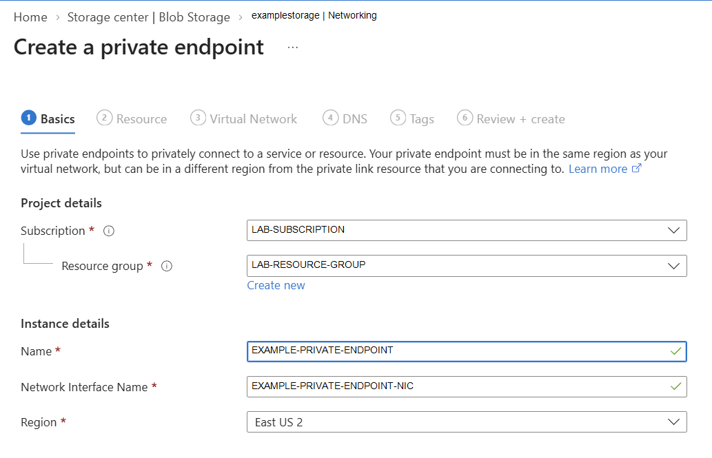
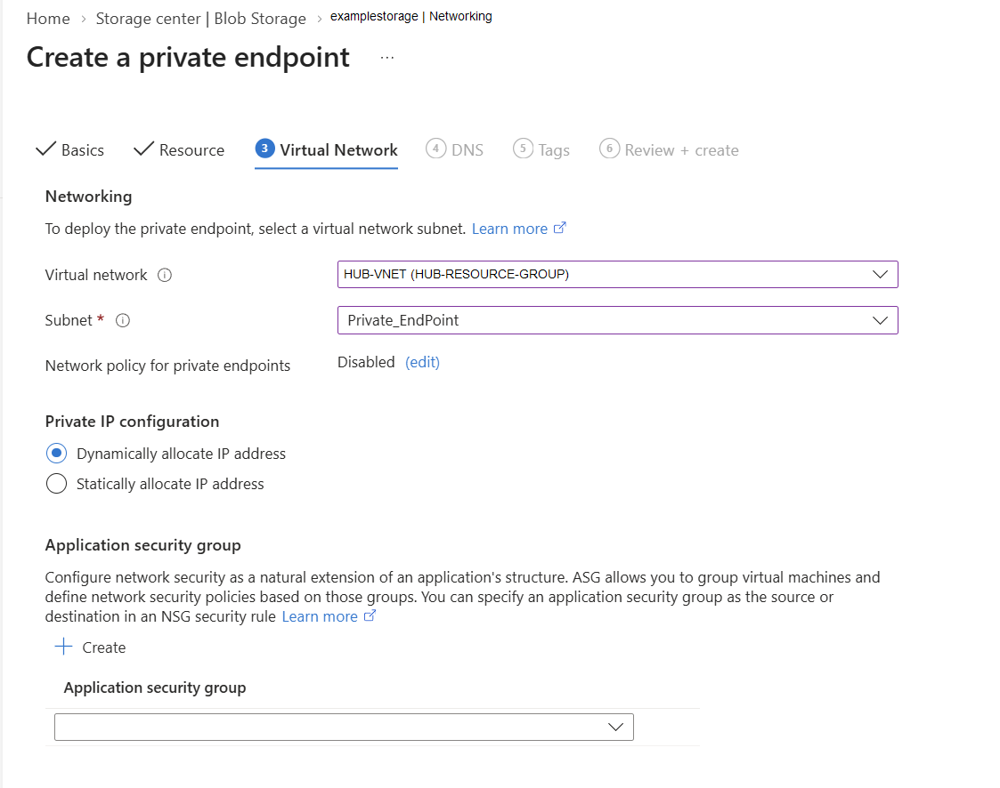
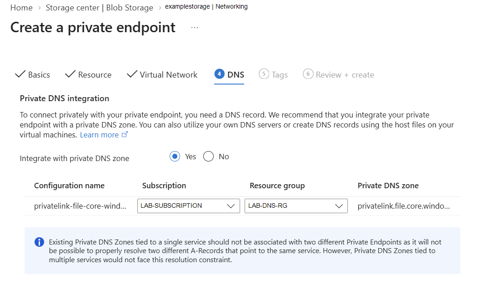
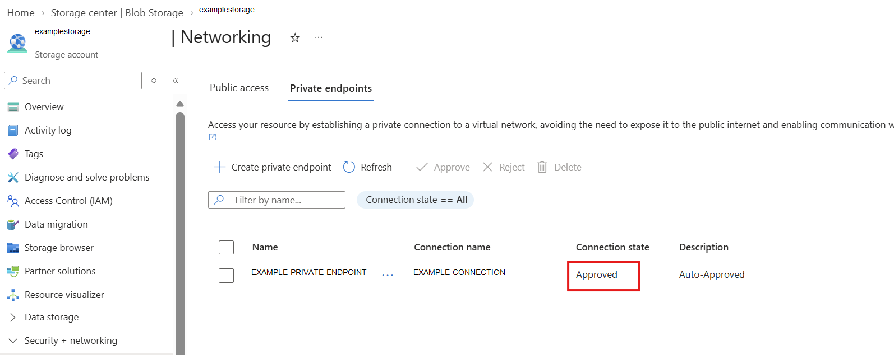
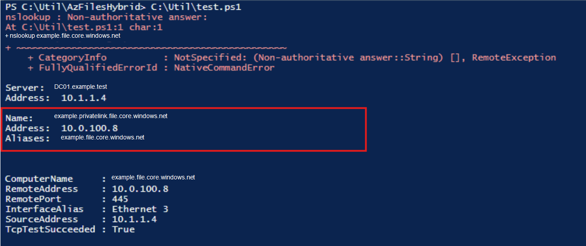
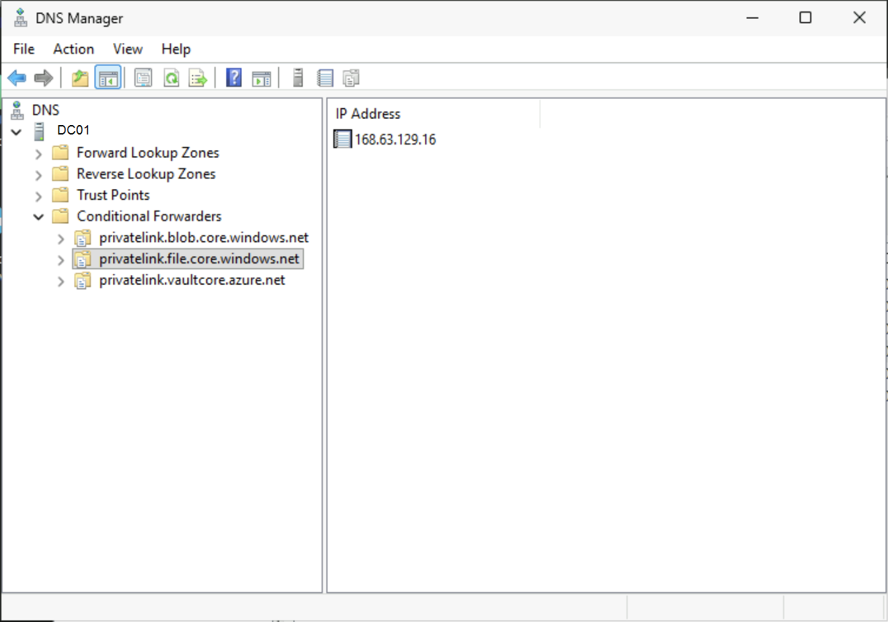
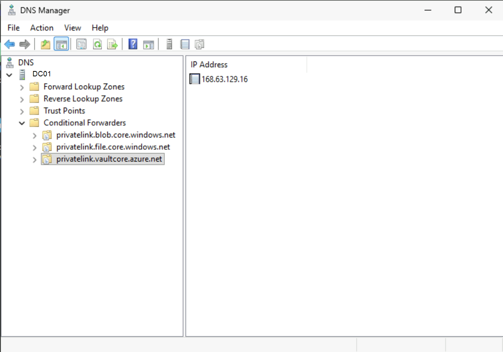

# Azure Private Endpoint for AVD with Custom DNS Configuration Guide 

This guide helps IT professionals understand how Azure Private Endpoints work, including implementation and troubleshooting. I use an Azure Virtual Desktop (AVD) scenario to provide practical context. Because this guide explains the solution end to end, all steps are shown in the Azure portal. The approach is aligned with AVD Accelerator guidance (https://github.com/Azure/avdaccelerator).

## Guide format

This is a **README-centric guide**. You can complete the implementation from this page only.  
The `/docs` folder remains available for deep-dive references and troubleshooting details.

## Architecture design artifact

For the formal Hub-Spoke design aligned to Step 0 requirements, use:

- [Design: Hub-Spoke with Private Endpoints and Custom DNS](docs/00-design-hub-spoke-and-dns.md)
- Diagram source file: `diagrams/avd-private-endpoint-dns-topology.mmd`

## Environment definitions (custom baseline)

To make the flow clear, this is the model used in this implementation:

- Network topology uses **Hub-Spoke**.
- Virtual Machines are created in **Spoke** networks according to role and segmentation.
- Private Endpoints (PE) use a dedicated subnet in the **Hub VNet**.
- The environment uses **Active Directory**, and DNS runs on Domain Controllers.
- At least one Domain Controller is deployed in Azure (recommended: two).
- Private DNS Zones for Storage and Key Vault are pre-created or created as part of prerequisites.

## What this guide covers

- End-to-end prerequisites and architecture decisions.
- Storage Account (**FileStorage + Premium**) setup for AVD FSLogix profiles.
- Private Endpoint placement in the **Hub** network.
- Private DNS Zone creation and linkage.
- AD DS DNS forwarder configuration (custom DNS scenario).
- Key Vault private access pattern aligned with the same DNS and networking model.
- Validation and troubleshooting.

## Reference baseline (sanitized)

> Sensitive identifiers should stay redacted in documentation and screenshots.

| Component | Baseline Pattern |
|---|---|
| Region | East US 2 |
| Network model | Hub/Spoke |
| Hub VNet CIDR | 10.0.0.0/16 |
| Hub PE subnet | `Private_EndPoint` (`10.0.100.0/24`) |
| Spoke VNet CIDR | 10.1.0.0/16 |
| Domain Controller subnet | `10.1.1.0/24` |
| AVD session host subnet | `10.1.2.0/24` |
| Custom DNS servers used by VNets | `10.1.1.4`, `10.1.1.5` |
| Private DNS zones | `privatelink.file.core.windows.net`, `privatelink.vaultcore.azure.net` |

## Why Hub-based Private Endpoints make sense for AVD

- Centralizes private ingress/egress control and policy.
- Scales across multiple AVD pools/spokes without duplicating endpoint strategy.
- Keeps DNS resolution predictable with one custom DNS authority plane (AD DS DNS).
- Standardizes private link patterns for both Storage and Key Vault.

## Step-by-step implementation (Portal-first)

## Step 0 - Prerequisites

The network design below shows the core components to validate.
1. Confirm Hub/Spoke VNets are deployed and peered.
   Confirm communication is allowed between VNets. In AVD deployments, Domain Controllers are often on-premises, so communication must flow across connectivity links such as ExpressRoute or Site-to-Site VPN.
2. Confirm a dedicated Private Endpoint (PE) subnet exists in the Hub.
   A Private Endpoint is a network interface deployed in an Azure VNet. For standardization, this guide uses one dedicated subnet in the Hub VNet for Private Endpoints.
3. Confirm AD DS DNS servers are reachable from AVD subnets.
   Active Directory relies on DNS, so validating name resolution across all VNets and subnets is required.
4. Confirm or create private DNS zones:
   Validate that the private DNS zones are created and correctly configured.
   - `privatelink.file.core.windows.net`
   - `privatelink.vaultcore.azure.net`
   Each private DNS zone must be linked to the VNets that host the Private Endpoints and the VMs that require name resolution.
5. Confirm VNet custom DNS settings point to AD DS DNS IPs.
   With custom DNS, VNets must use your DNS servers instead of Azure-provided DNS. In this design, those DNS servers resolve AD DS services.

## Network Design


## Step 1 - Create Storage Account for AVD Files Premium
This section highlights only the most important parameters.

1. Go to **Storage accounts** > **Create**.
2. Set:
   - Select **Subscription**
   - Select or create a **Resource Group**
   - Define the **Storage Account Name**
   - Select the **Region**
   - Primary service: **Azure Files**
   - Media tier: **Premium**
   - File share billing **Provisioned v2**
   - Redundancy: **LRS**

3. In **Advanced**, select **Enable managed identity for SMB** under Azure Files.
4. Create the file share for FSLogix profiles.


## Step 2 - Check the Storage Account Public Endpoint

Get the storage account FQDN from:


From AVD session host or DNS server, validate:

```powershell
nslookup <storageaccount>.file.core.windows.net
Test-NetConnection <storageaccount>.file.core.windows.net -Port 445
```


Validate that the storage account resolves to a public IP and that the storage account aliases match the public endpoint. This baseline is important for the next steps. At this stage, only the public alias exists. After creating the Private Endpoint, additional private-link records and aliases will appear.

## Step 3 - Create Storage Private Endpoint in Hub

Now create a Private Endpoint for the newly created storage account.

1. Open the storage account > **Networking** > **Private endpoint** > **Create private endpoint**.
2. Define **Name** and **Network Interface Name** for the virtual adapter that will be created in the Private Endpoint subnet.

3. Select target sub-resource: **file**.
4. Place the PE in the Hub VNet Private Endpoint subnet.

5. Integrate with `privatelink.file.core.windows.net`.

6. Confirm PE status is **Approved**.


## Step 4 - Check the Storage Account Private Endpoint

Repeat the validation from Step 2 and review what changed.

From AVD session host or DNS server, validate:

```powershell
nslookup <storageaccount>.file.core.windows.net
Test-NetConnection <storageaccount>.file.core.windows.net -Port 445
```


Validate that the storage account now resolves to a private IP and that `privatelink` appears in the resolved DNS path.

## Step 5 - Configure AD DS DNS conditional forwarders

1. On Azure-hosted Domain Controller DNS server(s), open **DNS Manager**.
2. Under **Conditional Forwarders**, add:
   - `privatelink.file.core.windows.net` -> `168.63.129.16`
   - `privatelink.vaultcore.azure.net` -> `168.63.129.16`
3. Replicate in AD as required.

Why: the DNS server inside Azure receives the query and forwards Azure private-link zones to Azure DNS.
  


## Step 6 - Create Key Vault Private Endpoint in Hub

1. Open Key Vault > **Networking** > **Private endpoint connections** > **+ Private endpoint**.
2. Select sub-resource: **vault**.
3. Place PE in Hub VNet PE subnet.
4. Integrate with `privatelink.vaultcore.azure.net`.
5. Confirm PE status is **Approved**.

[SCREENSHOT: 04-A - Key Vault PE creation wizard]  
[SCREENSHOT: 04-B - Key Vault PE approved]

## Step 7 - Validate end to end

From AVD session host and DNS server, validate:

```powershell
nslookup <storageaccount>.file.core.windows.net
nslookup <keyvault>.vault.azure.net
Test-NetConnection <storageaccount>.file.core.windows.net -Port 445
Test-NetConnection <keyvault>.vault.azure.net -Port 443
```

Expected result: DNS resolves to private IPs and network access works through private endpoints.


[SCREENSHOT: 05-A - nslookup storage private IP]  
[SCREENSHOT: 05-B - nslookup key vault private IP]  
[SCREENSHOT: 05-C - port 445 test success]

## Step 8 - Screenshot redaction and publishing checklist

Before publishing:

- Redact subscription ID, tenant ID, public IPs, hostnames, and user identities.
- Use opaque masking (not blur).
- Validate at zoom to ensure no sensitive text remains.
- Keep screenshot names consistent in `assets/screenshots/`.

See full checklist: [Screenshot redaction QA](docs/06-screenshot-redaction-checklist.md).

## Deep-dive documents

- [Design: Hub-Spoke with Private Endpoints and Custom DNS](docs/00-design-hub-spoke-and-dns.md)
- [Architecture and prerequisites](docs/01-architecture-and-prereqs.md)
- [Storage Files Premium + Private Endpoint](docs/02-storage-files-premium-and-private-endpoint.md)
- [Key Vault Private Endpoint](docs/03-key-vault-private-endpoint.md)
- [Custom DNS forwarders on AD DS](docs/04-custom-dns-forwarders-on-ad-ds.md)
- [Validation and troubleshooting](docs/05-validation-and-troubleshooting.md)
- [Microsoft reference links](docs/07-microsoft-reference-links.md)

## Repository structure

```text
.
├─ README.md
├─ diagrams/
│  └─ avd-private-endpoint-dns-topology.mmd
├─ docs/
│  ├─ 00-design-hub-spoke-and-dns.md
│  ├─ 01-architecture-and-prereqs.md
│  ├─ 02-storage-files-premium-and-private-endpoint.md
│  ├─ 03-key-vault-private-endpoint.md
│  ├─ 04-custom-dns-forwarders-on-ad-ds.md
│  ├─ 05-validation-and-troubleshooting.md
│  ├─ 06-screenshot-redaction-checklist.md
│  └─ 07-microsoft-reference-links.md
└─ assets/
   └─ screenshots/
      └─ .gitkeep
```
