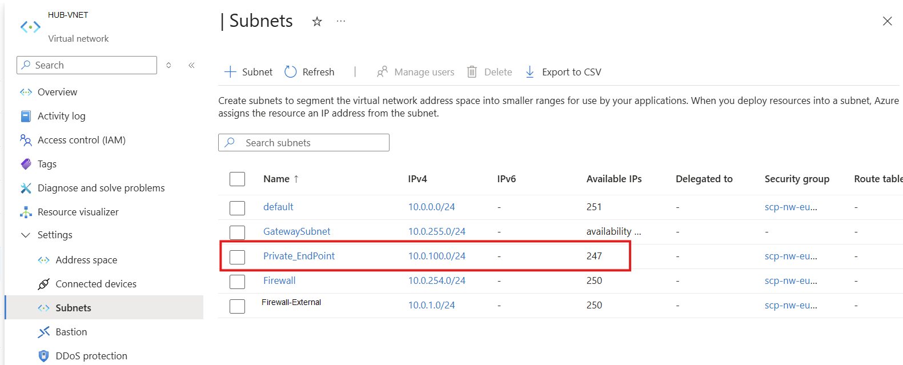
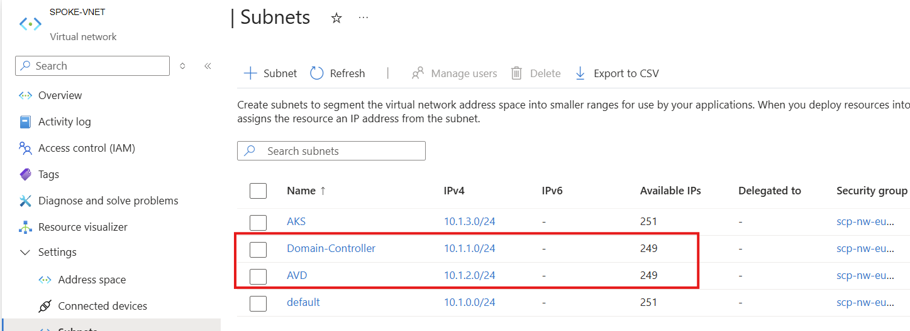
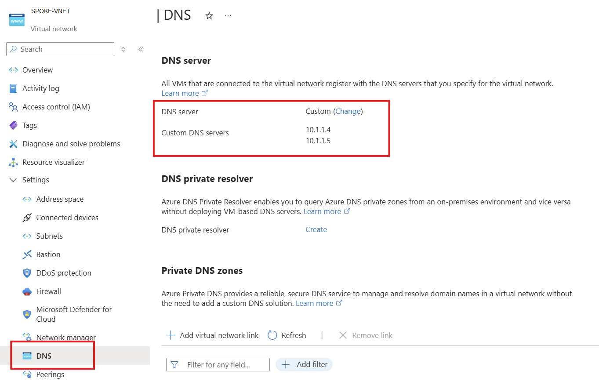
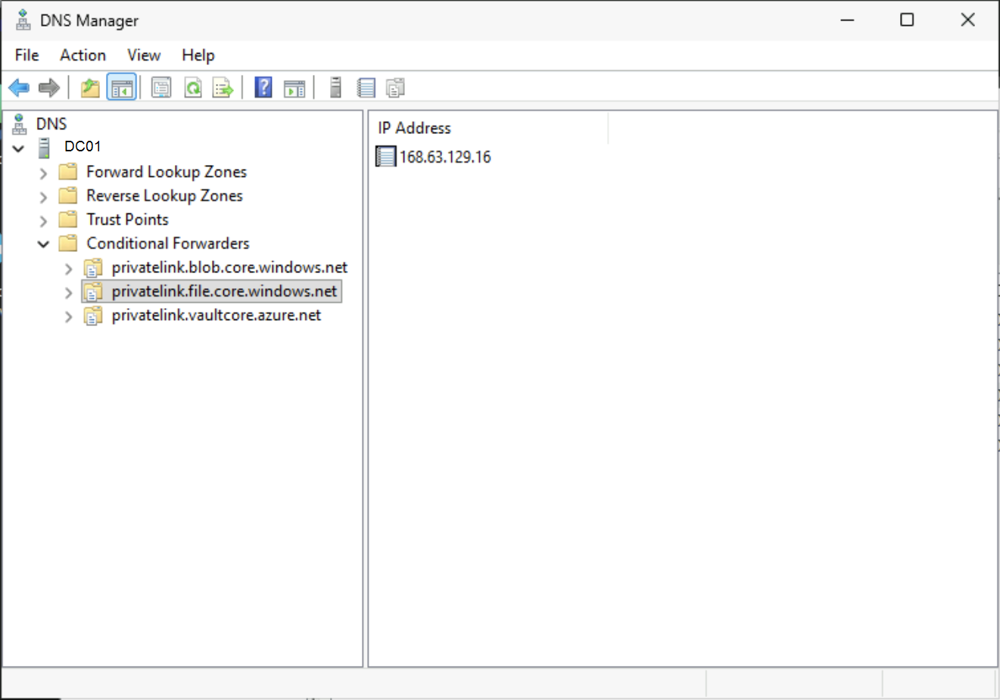
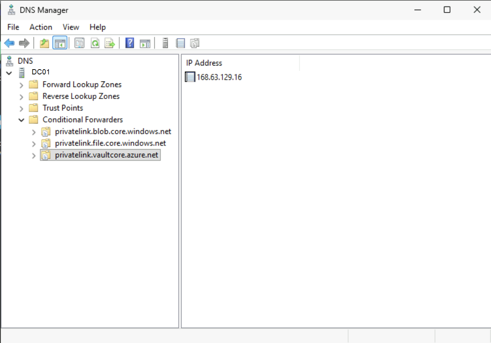
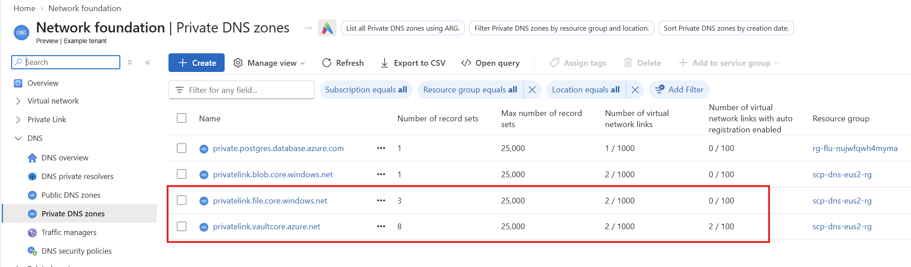
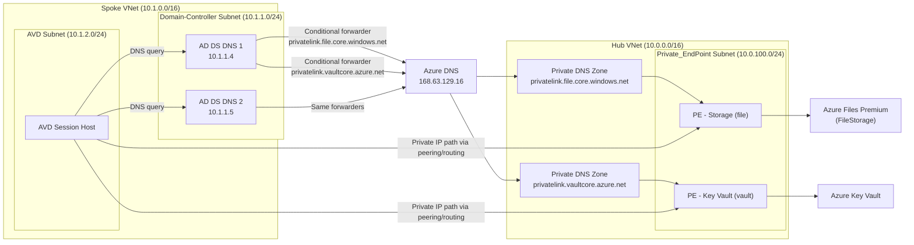

# 00 - Design: Hub-Spoke with Private Endpoints and Custom DNS

## Design goal

Provide a single architecture view that explains:

1. Hub VNet with a dedicated Private Endpoint subnet.

2. Spoke VNet with AVD subnet and Domain Controller subnet.

3. VNet DNS settings pointing to AD DS DNS servers.

4. Conditional forwarders on AD DS DNS to Azure DNS (`168.63.129.16`).

5. Private DNS zones for Storage and Key Vault.

## Architecture diagram

## Design decisions summary

- Private Endpoints are centralized in Hub for consistent policy and operations.
- AVD workloads stay in Spoke with segmented subnets.
- DNS remains authoritative in AD DS; private-link names are conditionally forwarded to Azure DNS.
